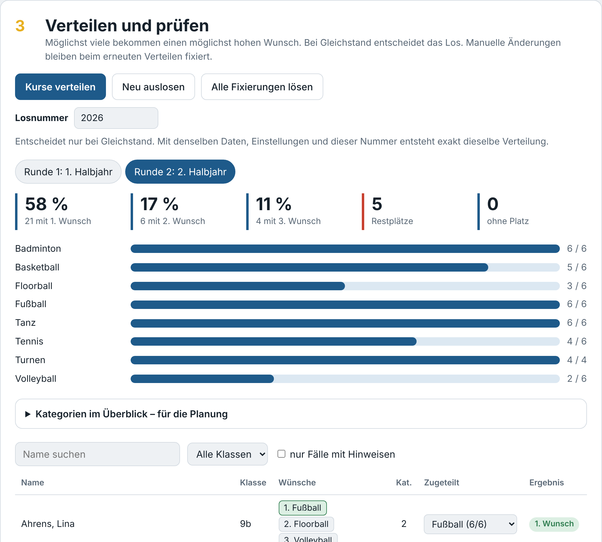

# Kurswahl verteilen

Ein schlankes Werkzeug, um Kurswahlen an Schulen fair zu verteilen – zum Beispiel Sportkurse, Wahlpflichtkurse, AGs oder Projektwochen. Die Wünsche werden über eine normale **itslearning-Umfrage** gesammelt, das Tool verteilt die Plätze und erstellt fertige Kurs- und Klassenlisten.

Das gesamte Werkzeug ist **eine einzige HTML-Datei**. Es braucht keinen Server, keine Installation und keine Anmeldung und läuft im Browser auf Mac, PC und iPad – auch offline.

**▶ [Tool im Browser öffnen](https://skb-referat10.github.io/kurswahl-tool/kurswahl-verteilen.html)** · [Startseite](https://skb-referat10.github.io/kurswahl-tool/) · [Anleitung mit Screenshots](docs/anleitung-itslearning.md) · [Datei herunterladen](https://github.com/skb-referat10/kurswahl-tool/raw/main/kurswahl-verteilen.html)

## Schnellstart

1. [Tool online öffnen](https://skb-referat10.github.io/kurswahl-tool/kurswahl-verteilen.html) – oder `kurswahl-verteilen.html` herunterladen und per Doppelklick im Browser öffnen.
2. „Mit Beispieldaten ausprobieren“ anklicken – oder die Dateien aus `testdaten/` laden.
3. Kurse, Plätze und Regeln einstellen, „Kurse verteilen“, Ergebnis als Excel sichern.

## Nutzen und installieren

Es gibt nichts zu installieren. Das Tool ist eine einzige Datei (`kurswahl-verteilen.html`), die in jedem aktuellen Browser läuft – Safari, Chrome, Edge oder Firefox. Es gibt drei Wege, es zu nutzen:

**1. Online öffnen (am einfachsten)**
Den Link [Tool im Browser öffnen](https://skb-referat10.github.io/kurswahl-tool/kurswahl-verteilen.html) aufrufen und loslegen. Das funktioniert auf Mac, PC und iPad. Die Schülerdaten werden auch hier **nur im eigenen Browser** verarbeitet und nicht hochgeladen. Beim Aufruf der Seite erfährt GitHub als Anbieter allerdings – wie bei jeder Webseite – die IP-Adresse des Geräts.

**2. Datei herunterladen und offline nutzen**
[`kurswahl-verteilen.html` herunterladen](https://github.com/skb-referat10/kurswahl-tool/raw/main/kurswahl-verteilen.html) und auf dem Dienstgerät speichern. Am Mac oder PC genügt danach ein Doppelklick, die Datei öffnet sich im Browser – auch ohne Internetverbindung. Auf dem iPad ist die Online-Version praktischer, weil die Vorschau der Dateien-App HTML-Dateien nicht zuverlässig als Programm ausführt.

**3. Auf einem eigenen Webserver bereitstellen**
Für den Dauerbetrieb, etwa für alle Schulen eines Trägers, kann die Datei auf einen schulischen oder behördlichen Webserver gelegt werden. Es reicht, die eine Datei hochzuladen; eine Datenbank oder serverseitige Programme sind nicht nötig. Dann sieht kein externer Anbieter die Aufrufe.

**Aktualisieren:** Eine neue Version ersetzt einfach die alte Datei. Gespeicherte Schulprofile (JSON) und Historien (CSV) bleiben gültig und können weiter geladen werden.

**Ergebnisse öffnen:** Der Excel-Export öffnet sich in Excel, Numbers oder LibreOffice, die Historie-CSV ebenso.

Eine ausführliche Anleitung mit Screenshots – von der itslearning-Umfrage über die SuBITI-Klassenlisten bis zu den fertigen Listen – steht in [`docs/anleitung-itslearning.md`](docs/anleitung-itslearning.md).

## Ablauf in der Schule

1. **Umfrage in itslearning** anlegen: eine Matrixfrage mit den Spalten „1. Wahl“, „2. Wahl“, „3. Wahl“ und den Kursen als Optionen. Für mehrere Halbjahre in einem Durchgang je Halbjahr eine Matrixfrage. Empfohlen: zusätzlich eine Frage „Klasse“.
2. **Export** der Ergebnisse als Excel-Datei.
3. **Einlesen** im Tool, dazu optional:
   - **Klassenlisten** aus dem SuBITI-Portal (Univention Management Console → Unterricht → Klassenlisten), eine oder mehrere Dateien, z. B. eine pro Klasse. Beide Exportformate werden gelesen. Genutzt werden Name, Klasse und Username.
   - **Historie** aus früheren Runden (die CSV, die das Tool selbst exportiert).
   - **Schulprofil** mit Kursen, Plätzen, Kategorien und Regeln (JSON, enthält keine Schülerdaten).
4. **Verteilen und prüfen**, bei Bedarf einzelne Zuteilungen von Hand ändern.
5. **Exportieren**: Excel mit Übersicht, einem Blatt pro Kurs (für die Kursleitungen), einem Blatt pro Klasse (für die Klassenleitungen), Kategorien-Übersicht, Hinweisen und Protokoll – plus die fortlaufende Historie als CSV für das nächste Halbjahr.

## Wie verteilt wird – einfach erklärt

### Die Grundidee: ein Puzzle für alle gleichzeitig

Das Tool verteilt **nicht der Reihe nach** – nicht nach Abgabezeit, nicht nach Alphabet und nicht „erst alle Erstwünsche, dann die Zweitwünsche“. Es betrachtet alle Schüler:innen und alle Plätze **gleichzeitig** und sucht die Verteilung, mit der die Gruppe insgesamt am zufriedensten ist.

Damit „am zufriedensten“ messbar wird, bekommt jede mögliche Zuteilung **Punkte für Unzufriedenheit**:

| Zuteilung | Punkte |
|---|---|
| 1. Wunsch | 0 |
| 2. Wunsch | 3 |
| 3. Wunsch | 7 |
| kein Wunsch (Restplatz) | 40 |

Gesucht wird die Verteilung mit der **kleinsten Gesamtsumme** – unter der Bedingung, dass kein Kurs mehr Teilnehmende hat als Plätze.

### Warum genau diese Punkte?

- **Lieber zweimal ein bisschen Pech als einmal viel:** Zwei Schüler:innen mit dem 2. Wunsch ergeben 3 + 3 = 6 Punkte. Eine mit dem 1. und eine mit dem 3. Wunsch ergeben 0 + 7 = 7 Punkte. Das Tool entscheidet sich also für die gleichmäßigere Lösung.
- **Ein Restplatz ist das Letzte, was passieren soll:** 40 Punkte sind mehr als fünf Drittwünsche zusammen (5 × 7 = 35). Bevor jemand gar keinen Wunsch bekommt, rutschen also lieber mehrere andere auf ihren 2. oder 3. Wunsch.

### Ein Beispiel

Fußball hat **1 Platz**, Volleyball **2 Plätze**.

| | 1. Wunsch | 2. Wunsch |
|---|---|---|
| Anna | Fußball | Volleyball |
| Ben | Fußball | Volleyball |
| Cem | Volleyball | Fußball |

Mögliche Verteilungen und ihre Punkte:

| Fußball bekommt … | Anna | Ben | Cem | Summe |
|---|---|---|---|---|
| Anna | 0 | 3 | 0 | **3** |
| Ben | 3 | 0 | 0 | **3** |
| Cem | 3 | 3 | 3 | 9 |

Cem bekommt also sicher Volleyball, denn die dritte Lösung wäre für alle schlechter. Zwischen Anna und Ben herrscht **Gleichstand** – beide Lösungen sind genau gleich gut. Hier entscheidet das **Los**. Mit dem echten Tool nachgerechnet: Bei 1000 verschiedenen Losnummern bekam Anna den Fußballplatz 501-mal, Ben 499-mal.

Bei echten Wahlen mit hunderten Schüler:innen gibt es unvorstellbar viele mögliche Verteilungen. Das Tool probiert sie nicht einzeln durch, sondern nutzt ein bewährtes mathematisches Verfahren (einen sogenannten *Min-Cost-Flow*), das die beste Lösung garantiert und dafür nur Millisekunden braucht.

### Wie das Los funktioniert

Das Los entscheidet **nur bei echten Gleichständen** – also nur dann, wenn zwei Lösungen exakt gleich viele Punkte haben. Dafür wird die Reihenfolge der Schüler:innen vor jeder Verteilung zufällig gemischt, wie ein Kartenstapel. Bei gleich guten Lösungen setzt sich so zufällig eine durch. Die alphabetische Sortierung in der Anzeige spielt dabei keine Rolle.

Gemischt wird mit einer **Losnummer**. Sie funktioniert wie der Startpunkt beim Mischen: Dieselbe Nummer ergibt immer dieselbe Reihenfolge. Das hat zwei Vorteile:

- **Nachvollziehbar:** Mit denselben Dateien, denselben Einstellungen und derselben Losnummer entsteht exakt dieselbe Verteilung. Bei einer Rückfrage lässt sich das Ergebnis jederzeit wiederholen.
- **Kein heimliches Neu-Auslosen:** Jede Verteilung steht mit ihrer Losnummer im Protokoll. Wer so lange neu auslost, bis ihm ein Ergebnis passt, ist dort sichtbar.

Ein ehrlicher Hinweis: Das Mischen nutzt einen Zufallsgenerator, der aus der Losnummer berechnet wird, keinen Würfel. Er ist für eine faire Auslosung gut genug, wie die Simulationen zeigen, aber nicht für Glücksspiel oder Verschlüsselung gedacht.

### Der Ausgleich über Halbjahre

Ist die Regel „Ausgleich bei Gleichstand“ aktiv, bekommt bei einem Gleichstand zuerst dran, wer beim letzten Mal Pech hatte (3. Wunsch oder kein Wunsch). Technisch ist das ein winziger Zusatzpunkt, der **nur** dann den Ausschlag gibt, wenn zwei Lösungen sonst gleich gut wären. Niemand verliert dadurch einen Platz, den er sonst sicher bekommen hätte – es ändert sich nur, wer bei einem Gleichstand zuerst dran ist.

### Einstellbare Regeln

| Regel | Wirkung |
|---|---|
| Kurs nicht wiederholen | Niemand bekommt einen Kurs, den er schon hatte. |
| Kategorie begrenzen | Höchstens x Kurse pro Kategorie (z. B. Bewegungsfeld). |
| Vielfalt vor Wiederholung | Eine Kategorie erst wieder nach x verschiedenen Kategorien. |
| Kein Vorteil durch Mehrfachnennung oder unmögliche Wünsche | Mehrfach genannte und nach den Regeln nicht mögliche Wünsche zählen wie nicht angegeben und verschaffen keinen Vorrang. |
| Ausgleich bei Gleichstand | Wer zuletzt nur den 3. gültigen Wunsch oder keinen Wunsch bekam, ist bei Gleichstand zuerst dran. Von Hand geänderte Plätze zählen nicht. |
| Restplätze vergeben | Wer keinen Wunsch bekommt, landet in einem Kurs mit freien Plätzen. |

Das Protokoll-Blatt im Export dokumentiert Regeln, Losnummern, jede manuelle Änderung und jede Namenszuordnung.

### Wie Tricks ausgeschlossen werden

Ein faires Verfahren muss auch dann fair bleiben, wenn jemand versucht, es auszutricksen. Zwei Lücken haben wir beim Testen gefunden und geschlossen – beide nach dem Prinzip **„Ungültige Wünsche zählen wie nicht angegeben“**:

- **Dreimal derselbe Kurs:** Wer nur einen Kurs angibt, konnte bei einem überbuchten Kurs nicht verdrängt werden, ohne einen Restplatz zu bekommen – und wurde deshalb bevorzugt. In einer Simulation (20 Plätze, 30 Erstwünsche) bekamen diese Schüler:innen ihren Kurs zu 100 %, alle anderen zu 58 %. Jetzt liegen beide bei 67 %.
- **Gesperrte Ausweichwünsche:** Derselbe Effekt ließ sich erreichen, indem man als 2. und 3. Wunsch Kurse angibt, die nach den Regeln gar nicht möglich sind (z. B. aus einer schon belegten Kategorie). Auch hier: vorher 100 % gegen 58 %, jetzt 67 % für alle.

Außerdem richtet sich der **Ausgleich** im nächsten Halbjahr nach der Position unter den *gültigen* Wünschen. Wer zwei unmögliche Kurse vorne einträgt und seinen eigentlichen Wunsch an dritter Stelle, bekommt dadurch keinen Vorrang bei der nächsten Wahl. Die fortlaufende Historie enthält dafür eine eigene Spalte „Ausgleich“.

Der Text für die itslearning-Umfrage erklärt diese Regeln den Schüler:innen offen.

## Namen abgleichen

- Abweichende Schreibweisen (z. B. „Juna“ / „Juna-Marie“, „Lüders“ / „Lueders“) schlägt das Tool zur Prüfung vor; ein Mensch entscheidet.
- Gleiche Namen werden nie still zusammengeführt: Das Tool fragt „eine Person oder zwei?“ und lässt die Einträge der Klassenliste von Hand zuordnen.
- Mit einer **Username-Spalte** in der Klassenliste (und idealerweise im Umfrage-Export) ist die Zuordnung eindeutig; die Historie läuft dann über den Benutzernamen.

## Bewusst nicht umgesetzt: Verteilung nach Geschlecht

Beim Bremer BildungsBarcamp kam die Idee auf, das Geschlecht in der Umfrage abzufragen und die Kurse damit gleichmäßig mit Jungen und Mädchen zu besetzen. Wir haben uns bewusst dagegen entschieden:

- **Gleichbehandlung:** Die Verteilung richtet sich ausschließlich nach den Wünschen. Für das Verfahren ist das Geschlecht irrelevant – damit gelten für alle dieselben Regeln.
- **Echte Wünsche gehen vor:** Eine Quote würde Wünsche verdrängen. Ein Mädchen bekäme Fußball dann nicht, weil der Kurs „schon genug Mädchen“ hat. Das wäre gegenüber Schüler:innen und Eltern kaum zu begründen.
- **Datensparsamkeit:** Nach der DSGVO sollen nur Daten erhoben werden, die für den Zweck nötig sind. Für eine Kurswahl ist das Geschlecht nicht nötig.
- **Keine Zuordnung erzwingen:** Eine Abfrage „Junge/Mädchen“ zwingt Schüler:innen, sich einzuordnen. Für Jugendliche, die sich als divers verstehen oder noch unsicher sind, ist das unangenehm – und mit einer dritten Option wird eine Quotenregel schnell widersprüchlich.

Wird ein Kurs im Einzelfall sehr einseitig besetzt, kann die Lehrkraft einzelne Plätze von Hand tauschen. Diese Änderungen werden im Protokoll dokumentiert.

## Datenschutz

- Alle Daten werden **ausschließlich lokal im Browser** verarbeitet. Die Datei baut keine Verbindung nach außen auf; die Excel-Bibliothek ist eingebettet, es werden keine Schriften oder Skripte nachgeladen.
- Es wird nichts im Browser gespeichert. Ergebnisse existieren nur als Dateien, die man selbst exportiert.
- Aus Klassenlisten werden nur Name, Klasse und Username/E-Mail gelesen. Weitere Spalten (z. B. Personalnummern) werden ignoriert und nicht exportiert.
- Exportierte Ergebnislisten und die Historie-CSV enthalten personenbezogene Daten und gehören auf Dienstgeräte bzw. in die schulische Ablage – **nicht in dieses Repository**. Die `.gitignore` schließt typische Exportdateien und einen Ordner `echtdaten/` aus.

## Testdaten

Alle Dateien in `testdaten/` sind **frei erfunden**:

| Datei | Inhalt |
|---|---|
| `testdaten-wahl-hj1.xlsx`, `testdaten-wahl-hj2.xlsx` | itslearning-Exporte für zwei Halbjahre, 2. Halbjahr mit neuen Kursen |
| `testdaten-wahl-export.xlsx` | ein Export mit zwei Halbjahren in einer Umfrage, inklusive Stolpersteinen |
| `testdaten-klassenliste.xlsx` | Klassenliste 10a–10c (Nachname, Vorname, Klasse) |
| `testdaten-schulverwaltung-10a/b/c.csv` | dieselben Klassen im Format der Schulverwaltung (UTF-16, Tabulator, mit Username) |
| `testdaten-historie.csv` | Kurse aus Jahrgang 9 |
| `testdaten-schulprofil.json` | Kurse, Plätze, Kategorien und Regeln |

## Status

Prototyp. Vor dem Einsatz an einer Schule bitte mit der Schulleitung und den Datenschutzverantwortlichen klären. Entstanden im Dialog mit einer KI (Claude) im Team digitale Schulentwicklung, Referat 10, Senator für Kinder und Bildung Bremen.

## Lizenzen

Das Tool steht unter der MIT-Lizenz (siehe `LICENSE`) und darf von Schulen frei genutzt, angepasst und weitergegeben werden. Eingebettet ist [SheetJS Community Edition](https://sheetjs.com) 0.18.5 (Apache License 2.0), siehe `THIRD_PARTY_NOTICES.md`.
