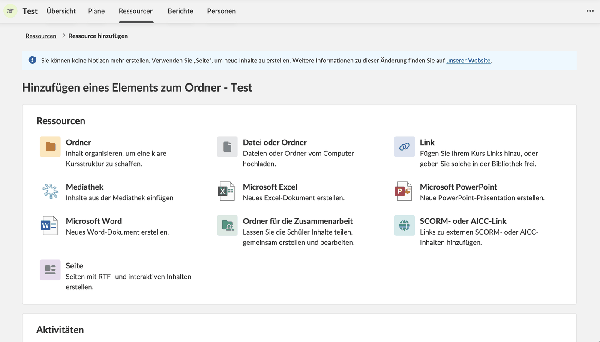
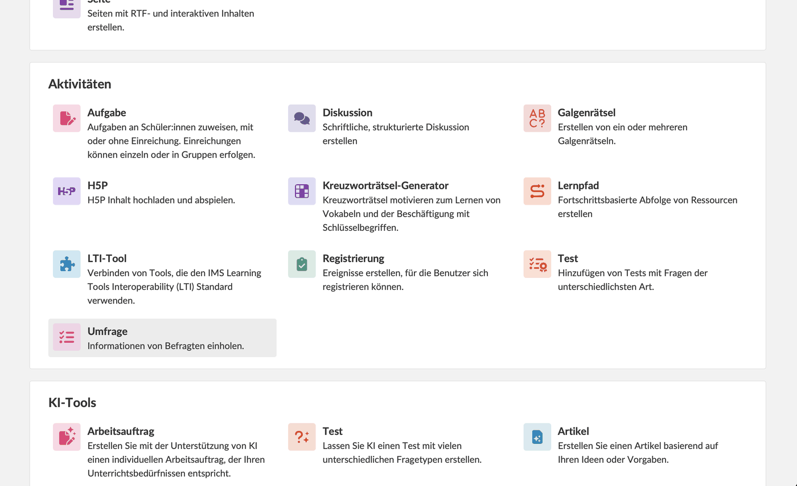
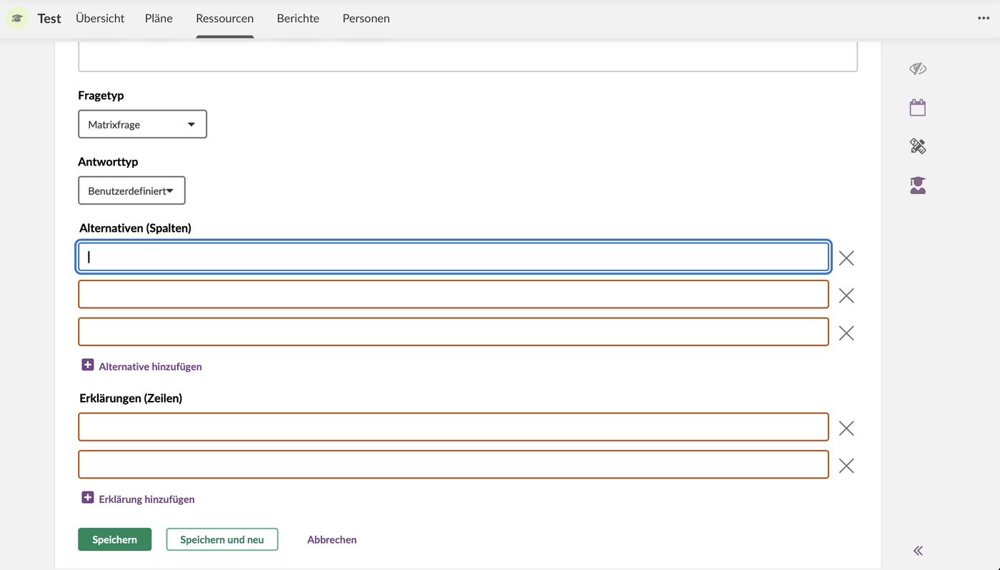
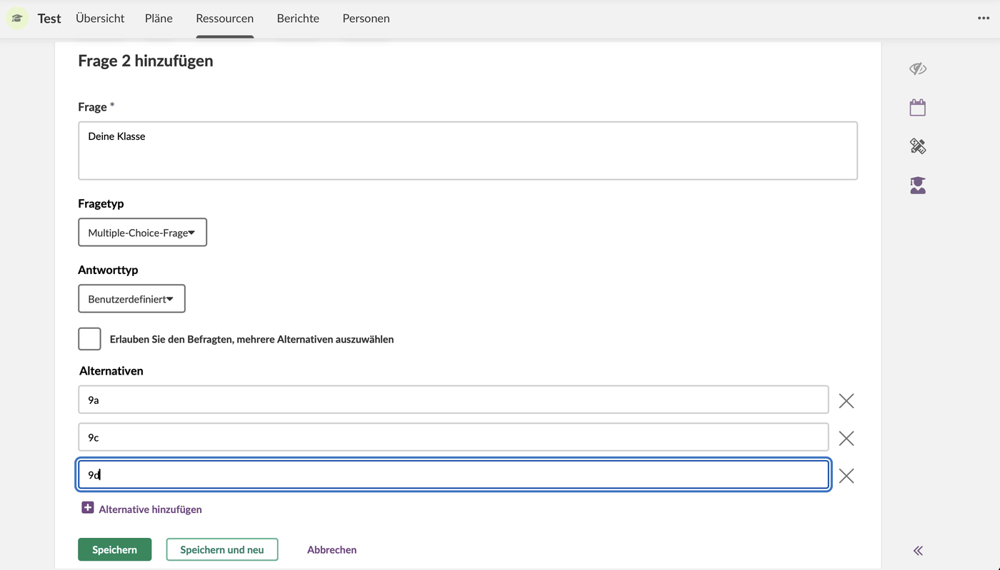
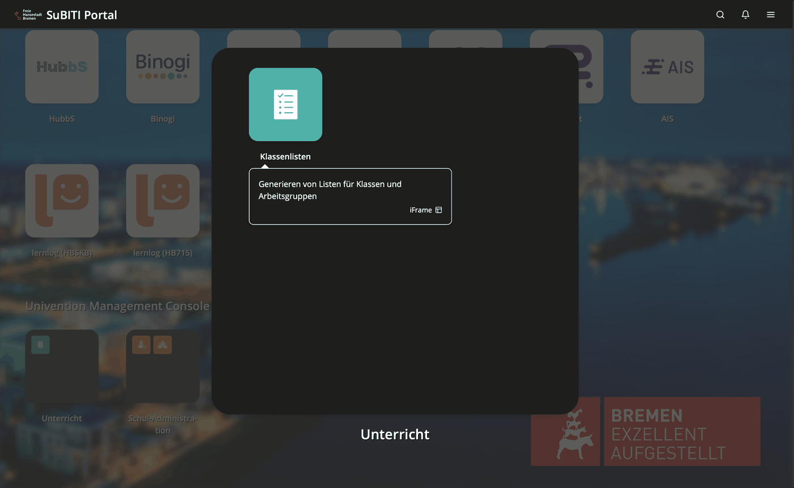
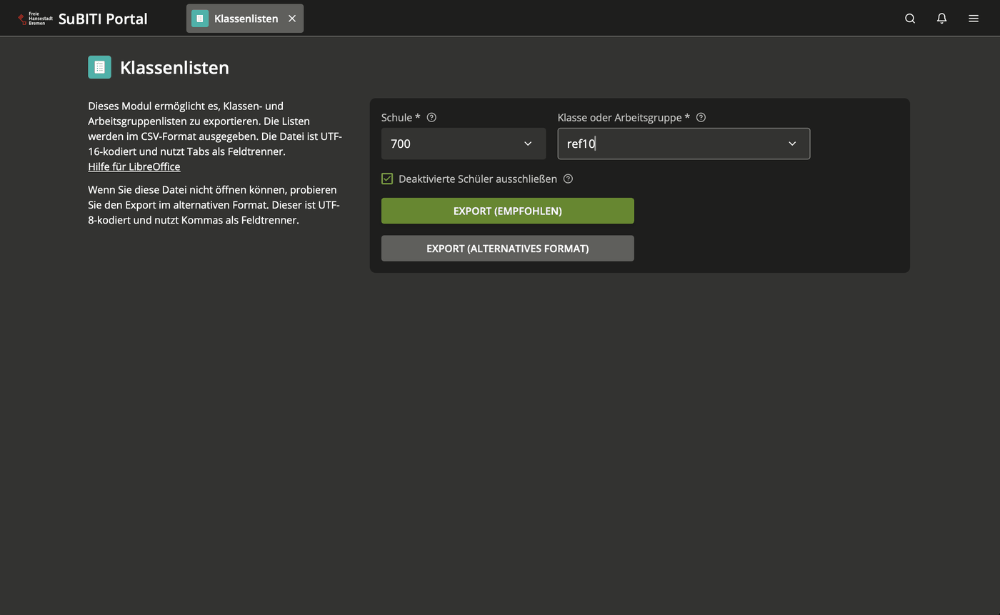

# Anleitung: Kurswahl mit itslearning, SuBITI und dem Kurswahl-Tool

Diese Anleitung führt Schritt für Schritt von der Umfrage in itslearning über die Klassenlisten aus dem SuBITI-Portal bis zu den fertigen Kurs- und Klassenlisten. Sie richtet sich an Fachleitungen und Lehrkräfte an Bremer Schulen, die eine Wahl organisieren.

## 1. Umfrage in itslearning anlegen

Öffne den Kurs, in dem alle wählenden Schüler:innen Mitglied sind, und gehe zu **Ressourcen → Ressource hinzufügen**.

Wähle unter **Aktivitäten** die **Umfrage** („Informationen von Befragten einholen“). Gib ihr einen aussagekräftigen Titel, z. B. „Sportkurswahl 1. Halbjahr 2026/27“, und stelle sicher, dass die Umfrage **nicht anonym** ist – sonst fehlen im Export die Namen.

Im Reiter **Fragen** legst du mit **Frage hinzufügen** die Fragen an.

### Frage 1: die Kurswahl als Matrixfrage

| Feld | Eintrag |
|---|---|
| Frage | z. B. „Sportkurs 1. Halbjahr 2026/27“ – dieser Text wird im Tool zur Bezeichnung der Runde und landet in der Historie. Am besten eindeutig mit Halbjahr und Schuljahr. |
| Fragetyp | **Matrixfrage** |
| Antworttyp | **Benutzerdefiniert** |
| Alternativen (Spalten) | **die Kurse**, je Kurs eine Alternative: Fußball, Volleyball, Floorball … |
| Erklärungen (Zeilen) | genau drei Zeilen: **`1. Wahl`**, **`2. Wahl`**, **`3. Wahl`** |

> ⚠️ **Wichtig: Kurse in die Spalten, Wahlen in die Zeilen.** Andersherum (Kurse als Zeilen, „1. Wahl“ usw. als Spalten) entsteht ein anderer Export, den das Tool nicht einlesen kann. Die Schreibweise „1. Wahl“ mit Punkt und Leerzeichen muss stimmen, daran erkennt das Tool die Spalten.

Sollen mehrere Halbjahre in einem Durchgang gewählt werden, legst du pro Halbjahr eine eigene Matrixfrage dieser Art an.

### Frage 2: die Klasse (empfohlen)

| Feld | Eintrag |
|---|---|
| Frage | z. B. „Deine Klasse“ – das Wort **Klasse** muss vorkommen |
| Fragetyp | **Multiple-Choice-Frage** |
| Antworttyp | **Benutzerdefiniert** |
| Mehrere Alternativen erlauben | **nicht** anhaken |
| Alternativen | die Klassen, z. B. 9a, 9b, 9c, 9d |

Die Klassenfrage hilft dem Tool, Schüler:innen mit gleichem Namen auseinanderzuhalten, und macht die Zuordnung zur Klassenliste sicherer.

## 2. Wahl ankündigen

Den Text für die Beschreibung der Umfrage erzeugt das Tool selbst: In Schritt 2 unter **„📝 Text für die itslearning-Umfrage“**. Er erklärt den Schüler:innen genau die Regeln, die du eingestellt hast – Mehrfachnennungen, Restplätze, Ausgleich, Wiederholungen und Bereiche (Kategorien) mit den zugehörigen Kursen. Das geht schon **vor** der Wahl: Tool öffnen, Regeln einstellen oder das Schulprofil laden, Text anpassen und mit „Text kopieren“ in die Umfrage übernehmen.

Mit den Standardregeln lautet er zum Beispiel:

> **So funktioniert die Wahl**
> Gib deinen 1., 2. und 3. Wunsch an – bitte drei verschiedene Kurse.
> • Fair verteilt: Die Plätze werden so vergeben, dass möglichst viele einen möglichst hohen Wunsch bekommen. Name, Klasse und der Zeitpunkt deiner Abgabe spielen keine Rolle. Ist ein Kurs bei gleich guten Wünschen überbucht, entscheidet das Los.
> • Dreimal derselbe Kurs? Das zählt wie ein einziger Wunsch und bringt dir keinen Vorteil. Mit drei verschiedenen Wünschen steigt deine Chance, dass einer davon klappt.
> • Kein Wunsch mehr frei? Dann bekommst du einen Platz in einem Kurs, der noch freie Plätze hat.
> • Ausgleich: Wer bei der letzten Wahl nur den 3. Wunsch oder einen Restplatz bekommen hat, ist bei der nächsten Wahl bei einem Gleichstand zuerst dran.
> • Keine Wiederholung: Einen Kurs, den du schon hattest, kannst du nicht noch einmal bekommen. Wähle ihn deshalb nicht erneut.

## 3. Ergebnisse exportieren

Nach Ablauf der Frist exportierst du die Ergebnisse der Umfrage als **Excel-Datei**. Die Datei enthält ein Blatt „Antworten“ mit Name, Zeitstempel und je einer Spalte pro Wahl sowie ein Blatt „Zusammenfassung“. Speichere sie auf dem Dienstgerät oder in der schulischen Ablage, nicht in einer privaten Cloud.

## 4. Klassenlisten aus dem SuBITI-Portal exportieren (optional)

Mit der Klassenfrage aus Abschnitt 1 erstellt das Tool die Listen für die Klassenleitungen auch ohne Klassenliste. Die SuBITI-Klassenlisten lohnen sich zusätzlich, wenn du sehen willst, **wer noch nicht gewählt hat**, oder wenn Falschangaben bei der Klasse auffallen sollen.

Melde dich im **SuBITI-Portal** (passwort.schule.bremen.de) an. Unter **Univention Management Console** findest du die Kachel **Unterricht** und darin das Modul **Klassenlisten**.

Wähle **Schule** und **Klasse oder Arbeitsgruppe**, lass **„Deaktivierte Schüler ausschließen“** angehakt und klicke **Export (empfohlen)**. Wiederhole das für jede Klasse, die an der Wahl teilnimmt.

Das Tool liest beide Exportformate (das empfohlene im UTF-16-Format mit Tabulatoren und das alternative im UTF-8-Format mit Kommas). Du kannst alle Klassen auf einmal oder nacheinander laden. Verwendet werden nur **Vorname, Nachname, Klasse und Username**. Der Username macht die Zuordnung auch bei gleichen Namen eindeutig. Weitere Spalten wie E-Mail-Adresse, SVZ-Personalnummer oder Stabi-User-ID werden ignoriert und nicht exportiert.

## 5. Verteilen im Tool

Öffne `kurswahl-verteilen.html` im Browser (Doppelklick genügt, eine Internetverbindung ist nicht nötig).

1. **Wahlen einlesen:** den itslearning-Export laden. Prüfe die Hinweise, zum Beispiel zu doppelten Abgaben oder gleichen Namen, und entscheide sie.
2. **Kurse und Regeln:** Plätze und Kategorien pro Kurs eintragen und die Regeln einstellen. Beim zweiten Mal genügt es, das gespeicherte **Schulprofil** zu laden.
3. **Klassenlisten:** die SuBITI-Exporte laden. Offene Fragen zu ähnlichen oder gleichen Namen werden hier angezeigt.
4. **Historie** (ab dem zweiten Halbjahr): die Historie-CSV aus der letzten Runde laden.
5. **Kurse verteilen**, das Ergebnis prüfen und bei Bedarf einzelne Zuteilungen von Hand ändern, etwa wenn zwei Schüler:innen tauschen möchten. Von Hand geänderte Plätze bleiben beim erneuten Verteilen erhalten, stehen im Protokoll und werden in der Historie als „von Hand“ vermerkt. Beim Ausgleich im nächsten Halbjahr zählen sie nicht als Pech. Die Losnummer wird angezeigt und im Protokoll festgehalten.

## 6. Ergebnisse weitergeben

- **Ergebnis als Excel:** enthält eine Übersicht, ein Blatt pro Kurs für die Kursleitungen, ein Blatt pro Klasse für die Klassenleitungen, eine Kategorien-Übersicht für die Planung, die Hinweise und das Protokoll.
- **Fortlaufende Historie (CSV):** für die Wahl im nächsten Halbjahr aufbewahren. Sie enthält alle bisherigen Runden.
- **Schulprofil speichern:** Kurse, Plätze, Kategorien und Regeln für das nächste Mal.

Die Listen kannst du zum Beispiel über itslearning an die Kurs- und Klassenleitungen weitergeben. Ergebnisliste und Historie enthalten personenbezogene Daten und gehören auf Dienstgeräte oder in die schulische Ablage.

## 7. Bei Rückfragen

Das Protokoll-Blatt dokumentiert Regeln, Kapazitäten, Losnummer, jede manuelle Änderung und jede Namenszuordnung. Mit denselben Dateien, denselben Einstellungen und derselben Losnummer lässt sich die automatische Verteilung jederzeit exakt wiederholen.
